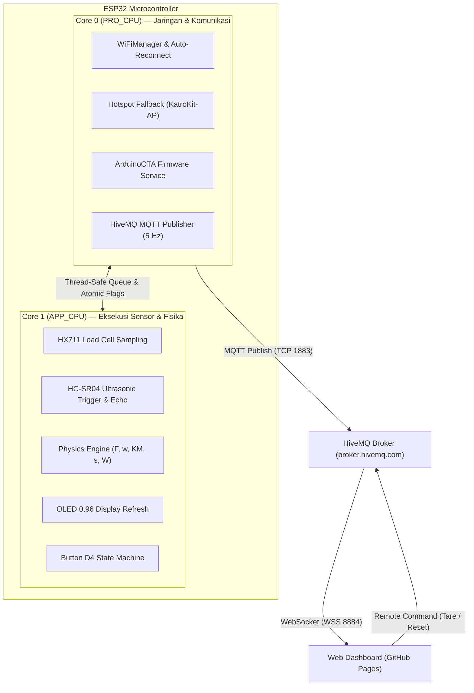

# 🪢 KatroKit ESP32 — IoT Physics Pulley & Work Laboratory

[](https://syahriltgr.github.io/KatroKit_esp32/)
[](https://www.espressif.com/)
[](https://platformio.org/)
[](https://www.hivemq.com/)

**KatroKit ESP32** adalah alat praktikum fisika modern berbasis mikrokontroler ESP32 untuk eksperimen **Sistem Katrol, Keuntungan Mekanis ($KM$), Perpindahan ($\Delta s$), dan Usaha/Kerja ($W$)**. Dilengkapi dengan pembacaan sensor presisi tinggi secara real-time, layar OLED onboard, arsitektur FreeRTOS Dual-Core, konektivitas cloud MQTT, serta dashboard interaktif berbasis web (GitHub Pages).

🌐 **Akses Live Dashboard:** [https://syahriltgr.github.io/KatroKit_esp32/](https://syahriltgr.github.io/KatroKit_esp32/)

---

## 📑 Daftar Isi

- [Fitur Utama](#-fitur-utama)
- [Konsep Fisika yang Diukur](#-konsep-fisika-yang-diukur)
- [Arsitektur Sistem (FreeRTOS Dual-Core)](#-arsitektur-sistem-freertos-dual-core)
- [Skema Pinout & Pengkabelan](#-skema-pinout--pengkabelan)
- [Panduan Penggunaan Tombol D4](#-panduan-penggunaan-tombol-d4)
- [Dashboard Web & Telemetri MQTT](#-dashboard-web--telemetri-mqtt)
- [Instalasi & Upload Firmware](#-instalasi--upload-firmware)
- [Desain Mekanik & Box Akrilik](#-desain-mekanik--box-akrilik)
- [Lisensi](#-lisensi)

---

## 🚀 Fitur Utama

- **Pengukuran Fisika Real-Time:**
  - **Gaya Kuasa ($F$):** Sensor Load Cell dengan amplifier HX711 24-bit.
  - **Ketinggian & Perpindahan ($\Delta s$):** Sensor ultrasonik HC-SR04 berpresisi milimeter.
  - **Keuntungan Mekanis ($KM$):** Dihitung otomatis dari perbandingan berat beban dan gaya kuasa ($KM = \frac{w}{F}$).
  - **Usaha ($W$):** Integrasi gaya dan perpindahan ($W = F \times \Delta s$).
- **Arsitektur FreeRTOS Dual-Core:**
  - **Core 1 (APP_CPU):** 100% didedikasikan untuk sampling sensor, kalkulasi fisika, dan refresh layar OLED (0 ms jitter / no lag).
  - **Core 0 (PRO_CPU):** Menangani WiFi, Hotspot portal, ArduinoOTA, dan streaming MQTT HiveMQ secara asinkron di latar belakang.
- **Tampilan Onboard OLED 0.96" I2C:** Menampilkan metrik utama fisika secara simultan dengan respon instan.
- **Navigasi Satu Tombol Cerdas (GPIO 4):** Berbagai fungsi praktis hanya dengan membedakan durasi tekan tombol.
- **Kalibrasi Load Cell Fleksibel:** Mendukung kalibrasi 1-titik standar dan kalibrasi 2-segmen non-linear (tersimpan di NVS/Flash).
- **Web Dashboard & Cloud Telemetry:** Streaming data 5 Hz ke public MQTT broker (HiveMQ) dengan validasi **Secret Token PIN**.
- **Remote Control & Ekspor CSV:** Kontrol Tare dari web dan ekspor seluruh log percobaan ke file spreadsheet CSV sekali klik.
- **Over-The-Air (OTA) Updates:** Update firmware nirkabel via WiFi lokal (`katrokit-esp32.local`).

---

## 🔬 Konsep Fisika yang Diukur

| Parameter Fisika | Simbol | Satuan | Rumus / Metode Perhitungan |
| :--- | :---: | :---: | :--- |
| **Gaya Kuasa** | $F$ | Newton ($\text{N}$) | Dibaca langsung oleh Load Cell pada tali penarik |
| **Gaya Kuasa Maksimum** | $F_{\text{max}}$ | Newton ($\text{N}$) | Nilai puncak tarikan selama satu siklus kerja |
| **Berat Beban** | $w$ | Newton ($\text{N}$) | Massa beban gantung ($m$) dikali gravitasi ($w = m \times g$) |
| **Perpindahan Beban** | $\Delta s$ | $\text{cm}$ / $\text{m}$ | Selisih jarak sensor terhadap posisi nol acuan ($\|s - s_0\|$) |
| **Keuntungan Mekanis** | $KM$ | Rasio | $KM = \frac{w}{F}$ *(Menentukan efisiensi jenis katrol)* |
| **Usaha / Kerja** | $W$ | Joule ($\text{J}$) | $W = F \times \Delta s$ |

---

## 🧠 Arsitektur Sistem (FreeRTOS Dual-Core)

Untuk memastikan pengukuran sensor tidak pernah tersendat oleh latensi jaringan WiFi atau TCP MQTT, firmware menggunakan pembagian tugas multi-core:



---

## 🔌 Skema Pinout & Pengkabelan

ESP32 DevKit 30-Pin terhubung ke modul-modul sensor melalui PCB Matrix:

| Modul Sensor | Pin Sensor | Terhubung ke ESP32 | Keterangan |
| :--- | :--- | :--- | :--- |
| **HX711 (Load Cell)** | VCC | `3.3V` | Catu daya logika 3.3V |
| | SCK | `GPIO 18` | Clock pulsa HX711 |
| | DT | `GPIO 19` | Data serial sinyal load cell |
| | GND | `GND` | Ground bersama |
| **HC-SR04 (Ultrasonik)** | VCC | `VIN (5V)` | Suplai 5V langsung dari USB |
| | TRIG | `GPIO 5` | Trigger pulsa ultrasonik 10 µs |
| | ECHO | `GPIO 17` | Melalui voltage divider $1\text{ k}\Omega$ : $2\text{ k}\Omega$ |
| | GND | `GND` | Ground bersama |
| **OLED 0.96" I2C** | VCC | `3.3V` | Suplai daya display |
| | GND | `GND` | Ground display |
| | SCL | `GPIO 22` | I2C Clock |
| | SDA | `GPIO 21` | I2C Data |
| **Push Button D4** | Pin 1 | `GPIO 4` | Input tombol (Internal Pull-Up) |
| | Pin 2 | `GND` | Ke ground |

> [!IMPORTANT]
> Pin `ECHO` pada HC-SR04 mengeluarkan sinyal 5V. Wajib menggunakan rangkaian resistor pembagi tegangan ($1\text{ k}\Omega$ ke ECHO dan $2\text{ k}\Omega$ ke GND) agar tegangan yang masuk ke `GPIO 17` aman di kisaran ~3.3V.

---

## 🔘 Panduan Penggunaan Tombol D4

Alat ini menggunakan **1 push button serbaguna** di bagian atas casing dengan logika durasi tekan yang intuitif:

```
[ Lepas Tombol ]
  ├─ < 1.5 detik   ──>  TARE (Nol-kan Gaya F dan Referensi Jarak s)
  ├─ 1.5 - 3 detik ──>  TIMBANG BEBAN W (Simpan bobot gantung saat ini sebagai W)
  ├─ 3 - 5 detik   ──>  PRESET BEBAN W (Pilihan cepat: 50g, 100g, 150g, 200g, 250g, 500g)
  └─ > 5 detik     ──>  WIZARD KALIBRASI (Kalibrasi 1-Titik atau 2-Segmen)
```

---

## 💻 Dashboard Web & Telemetri MQTT

Dashboard web dibangun menggunakan file HTML tunggal mandiri (`web/index.html`) dengan **Tailwind CSS**, **Chart.js**, dan **MQTT.js**.

- **URL Dashboard:** `https://syahriltgr.github.io/KatroKit_esp32/`
- **Broker MQTT:** `broker.hivemq.com`
- **Port:** `1883` (ESP32 TCP) & `8884` (Browser WSS) / `8000` (Browser WS)
- **Topik Telemetri:** `katrokit/<DEVICE_ID>/telemetry`
- **Topik Perintah:** `katrokit/<DEVICE_ID>/cmd`
- **Secret Token PIN Bawaan:** `katrokit2026`

### Contoh Payload Telemetri (JSON):
```json
{
  "token": "katrokit2026",
  "device_id": "katrokit_01",
  "f": 1.49,
  "f_max": 2.01,
  "w_n": 1.96,
  "w_g": 200.0,
  "km": 1.32,
  "dist": 18.8,
  "disp": 16.5,
  "work": 0.25,
  "cal": true,
  "raw": 70078,
  "rssi": -60
}
```

---

## 🛠️ Instalasi & Upload Firmware

Proyek ini menggunakan ekosistem **PlatformIO**.

### 1. Clone Repositori
```bash
git clone https://github.com/syahrilTGR/KatroKit_esp32.git
cd KatroKit_esp32
```

### 2. Compile Firmware
```bash
pio run
```

### 3. Upload via USB Serial
Sambungkan kabel USB Type-C ke ESP32, lalu jalankan:
```bash
pio run -t upload
```

### 4. Upload Nirkabel (OTA)
Jika ESP32 sudah terhubung ke jaringan WiFi yang sama:
```bash
pio run -t upload --upload-port katrokit-esp32.local
```

---

## 📐 Desain Mekanik & Box Akrilik

File desain manufaktur box akrilik (tebal 3 mm) dan layout PCB Matrix tersedia di direktori [`docs/`](file:///Volumes/Data%20Shared/Project/KatroKit_esp32/docs):

- **[`docs/acrylic_box_cutting.svg`](file:///Volumes/Data%20Shared/Project/KatroKit_esp32/docs/acrylic_box_cutting.svg)** — Pola potong laser cutting skala 1:1 (format SVG & DXF).
- **[`docs/pcb_matrix_loadcell_layout.svg`](file:///Volumes/Data%20Shared/Project/KatroKit_esp32/docs/pcb_matrix_loadcell_layout.svg)** — Panduan penataan tata letak komponen pada papan PCB Matrix ($25 \times 29$ lubang).
- **[`docs/design_spec.md`](file:///Volumes/Data%20Shared/Project/KatroKit_esp32/docs/design_spec.md)** — Spesifikasi mekanik lengkap dan kalkulasi Z-Stackup.

---

## 📄 Lisensi

Didistribusikan di bawah lisensi MIT. Silakan gunakan, pelajari, dan kembangkan untuk keperluan praktikum pendidikan dan riset fisika.

